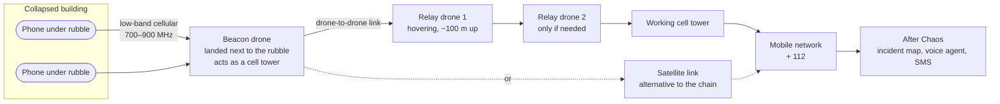
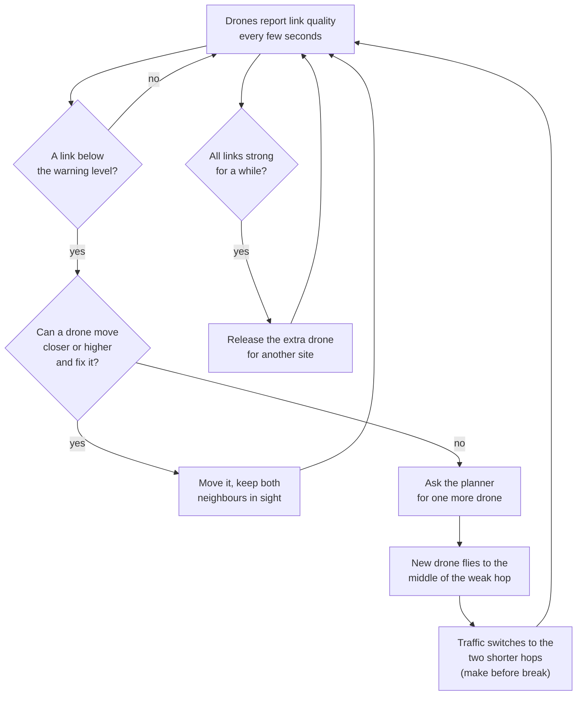
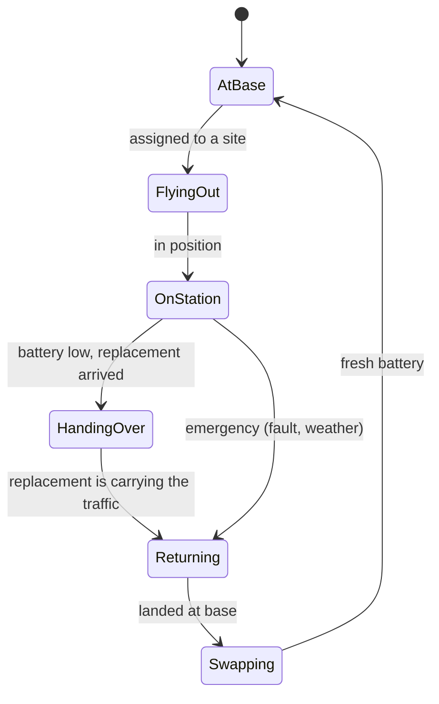
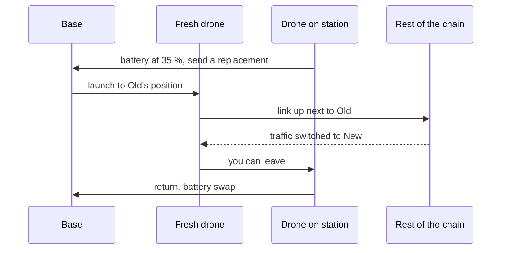
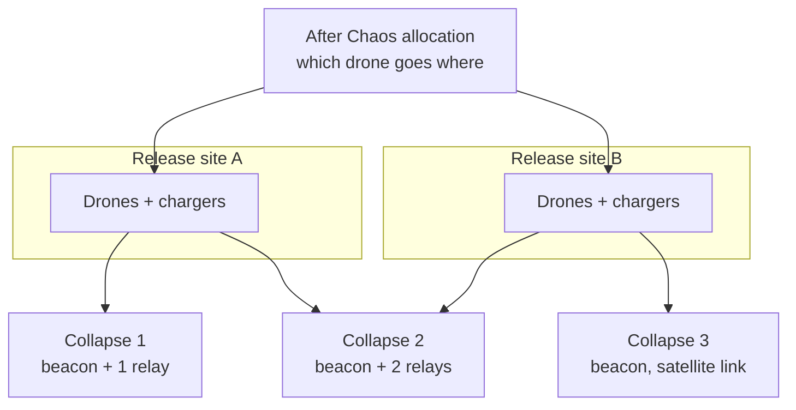
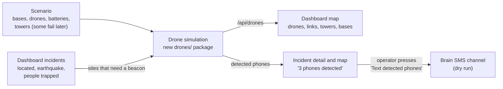

# 08 Drone beacon network

**Summary.** After an earthquake, people under rubble often still have a working phone but no signal. Rubble weakens a phone signal by a factor of 1,000 to 100 million, and the nearby cell towers may be down. The idea: a drone lands next to the collapsed building and acts as a strong, close cell tower of a mobile operator. A short chain of drones (or a satellite link) connects it to that operator's network. Phones of that operator underneath can then register on it, so rescuers learn that someone is there, roughly where, and can call or text them. A phone only registers on a cell its own operator's network can check, so without that link nothing registers, and phones of other operators or without a SIM show up only when they call 112. Drones take turns so the beacon never runs out of battery, and the same pool of drones can serve several collapse sites at once.

The parts already exist separately: drones that locate phones (NEC's SARDO, Centum's Lifeseeker), and drones that act as cell towers (AT&T's Flying COW). Putting them together for rubble, with rotation and several sites, is the new part. People do not install anything: phones are reached through the mobile network, as a government requirement on mobile operators. For the hackathon we simulate the drones and the phones on the operator dashboard's map (see the [build plan](#build-plan)); a real cellular beacon needs a mobile operator and the authorities on board.

## The idea in one picture

What each part does:

| Part | Job | Where it is |
|---|---|---|
| Beacon drone | Be the closest, strongest cell of the operator's network for phones under the rubble. Detect the phones that register, estimate where they are, carry their calls and texts. | Landed on safe ground next to the collapse |
| Relay drones | Carry the beacon's traffic, and its link to the operator's core network, to a cell tower that still works. Without this link (or the satellite link) no phone registers. | Hovering in a line, high enough to see each other |
| Satellite link | Same job as the relay chain, without the chain | On the beacon drone or on a ground vehicle |
| Base and chargers | Swap batteries, send fresh drones out | At each release location |
| After Chaos | Show detected phones on the incident map; talk to survivors by voice agent and SMS | Control room |

## Why phones under rubble go silent

Three things work against a trapped person's phone:

1. **Rubble blocks radio.** NIST measured radio signals inside buildings before and after they were demolished. Large amounts of rubble cost at least **30–40 dB**, and one collapsed apartment block **60–80 dB**. Metal debris sometimes helped by guiding the signal.
2. **The nearest towers may be down.** After the February 2023 earthquakes in Türkiye, power cuts and damaged sites disrupted mobile service, and an investigation was opened into the three mobile operators.
3. **Phones are weak transmitters.** A phone sends at most about 0.2 W. A tower can hear it far away in the open, but not through a collapsed building plus the distance to a distant tower.

**What "dB" means here.** Decibels count how many times weaker a signal gets: every 10 dB is 10 times weaker. So 30 dB is 1,000 times weaker, and 80 dB is 100 million times weaker. A beacon a few metres away instead of a tower kilometres away wins back much of that loss, because signal strength also falls fast with distance.

**Lower frequencies get through better.** NIST found lower frequencies generally reach into large buildings better. Phones already support the low cellular bands: 700 MHz (band 28), 800 MHz (band 20) and 900 MHz (band 8). One industry glossary puts the loss through a residential wall at about 7–10 dB at 700 MHz against 15–22 dB at 2,100 MHz (indicative figures, not a measurement study). So the beacon should use the **lowest band the phones support**, not a special frequency: a phone can only listen on bands it was built for.

**Bluetooth is weaker still.** Bluetooth Low Energy (BLE) runs at 2.4 GHz with even less power. A 2022 robot test detected phones reliably at about 15 m in the open; a Toronto study found BLE signals discoverable for over two days in abandoned buildings, but we found no measurement through actual rubble. BLE would also need an app on every phone. **Decision: no app.** People will not install one before a disaster, so phones are reached only through the mobile network.

## The beacon drone

### What it carries

A small cell (a cell tower in a box). Examples:

| Unit | Size | Notes |
|---|---|---|
| GreenCell (Virtual Network Communications) | About 2 kg with battery, 12.5 × 12.5 cm | Up to 128 users, about 2 km range, own core network built in (trade press). A built-in core cannot check real SIMs, so for real subscribers it still needs the operator's core (see [Which phones can use it](#which-phones-can-use-it)) |
| IWAVE Patron-X10 | Not listed | 10–20 W radio output, 128–200 users, sold for tethered drones (vendor claim) |

A 2 kg cell needs a large drone such as the DJI Matrice 350 RTK class, which carries up to about 2.7 kg (DJI: 9.2 kg maximum take-off weight, 6.47 kg with its two batteries). A single DJI gimbal mount takes at most 960 g, so the cell needs its own mount. The M350 is rated 55 min flight without payload, at 8 m/s in still air; with 2 kg on board it flies less.

### Why it should land

A hovering drone spends most of its energy staying in the air. Two figures, for two different drones:

- **DJI Matrice 350 RTK:** about 55 min on two 263 Wh batteries (526 Wh), without payload. That is about **0.6 kW** on average (our estimate from DJI's specs). With a 2 kg cell it is probably nearer **1 kW** (our estimate: hover power grows faster than weight; not measured).
- **A larger platform in a study of aerial base stations** (about 8 kg frame, 3 kg picocell, 5–9 kg battery): about **2 kW** in total.

A landed drone only powers the radio: tens of watts. The closest measurement we found is an open-source 5G base station (srsRAN on a USRP radio) drawing about **36–48 W** in total, but that was a server-class lab setup, so a drone payload should draw less. We found no figure for a specific drone small cell.

Rough illustration, with assumed numbers:

| | Power | Time on ~500 Wh (the M350 has 526 Wh) |
|---|---|---|
| Hovering with a picocell, study's larger platform | ~2,000 W | about 15 minutes |
| Hovering with a 2 kg cell, M350 | ~1,000 W (estimate) | about 30 minutes, less with a reserve to fly home |
| Landed, radio only | ~50 W (assumed) | about 10 hours |

So the beacon drone lands on safe, flat ground as close to the rubble as possible, and only the relay drones need frequent swaps. Landing also lets a rescuer move it by hand.

Next to rubble, safe ground means: away from walls that may still fall in an aftershock, out of the way of heavy machinery and rescue teams, and not where the rotors' dust blinds the crew or the drone's landing sensors. The rescue team on site should choose the spot. (Common-sense rules, no source found.)

### What it does

1. **Detects phones.** Phones of the partner operator register on the beacon once it is linked to the operator's core network, and the beacon sees each one that registers. Other phones appear only when they call 112 (see [Which phones can use it](#which-phones-can-use-it)).
2. **Estimates where they are, coarsely.** An LTE cell measures a phone's distance in timing-advance steps of about 78 m. So a single landed beacon knows only a ring around itself, about 78 m wide; for a phone next to the beacon, that is a circle of about 80 m. Signal strength through rubble adds little, because the rubble's loss is unknown. One beacon therefore tells rescuers that someone is alive near this site, not where in the rubble. A better position needs measurements from several positions: NEC's SARDO does this with a single moving drone and a machine-learning model that corrects for rubble, and a student project at EPFL, with a drone flying circles and measuring the phone's WiFi signal at many points, got within 10 m in its best tests. For a landed beacon, relay drones or a second beacon would have to add those measurements.
3. **Connects them.** Calls and texts go through the relay chain. A trapped person can call 112 and, if operators are busy, reach our voice agent. We can also text them first, the way the brain's failed-112-call trigger already does.
4. **Saves their battery.** Phones drain fastest where coverage is poor: they raise their transmit power to reach distant towers and keep searching for signal. A close beacon lets them transmit at low power. We found no measurement for phones under rubble, but the effect is well known. The first text to a detected phone should also tell the person how to save battery: low-power mode, screen dim. It should **not** suggest airplane mode, since that cuts them off from rescuers.

### Which phones can use it

A phone does not join any cell just because it is strong. To register, the phone proves its SIM to its own operator's core network, which holds the SIM's secret keys (in the HSS); the cell only passes the messages on (3GPP TS 33.401). So:

- **The beacon depends on its link.** It must run as a cell of the operator's network and reach the operator's core through the relay chain or the satellite link. A beacon with its own built-in core, such as GreenCell, cannot check real SIMs, so real subscribers cannot register on it alone. Without the link, nothing registers.
- **Phones of the same operator** register normally once the link works. These are the only phones the beacon can detect before anyone calls.
- **Phones of other operators and phones without a SIM** cannot register. They stay in what 3GPP calls the limited service state and contact the beacon only when the person makes an emergency call (3GPP TS 23.122). So they are **not detected until they call**.
- **Any phone can make an emergency call** on any available network, in that limited service state. Calls from phones **without a SIM** are decided per country: a 2024 European Commission report says 19 EU member states require them to be accepted (2023 data), while some refuse them to cut false calls. We did not find whether Greece is among the 19; Türkiye is not covered by EU data.
- **Texting and finding phones of other operators** needs those operators' cooperation, or one beacon per operator.

## The relay chain

The beacon's traffic has to reach a working network. Three ways:

| Option | How | Good | Bad |
|---|---|---|---|
| **Drone chain** (the original idea) | Relay drones hover in a line, each in sight of the next, to the nearest working tower | Uses the operator's own network; no extra service | Every relay needs rotation; each hop adds delay and a point of failure |
| **Satellite** | A Starlink Mini or similar on the beacon or on a nearby vehicle | No chain at all; works if every tower nearby is down | Uses about 25–40 W; needs open sky; a separate service and contract |
| **Tethered drone** | One drone on a cable from a ground vehicle that powers it | Flies for days (AT&T's Flying COW); high up, so it sees far | Needs a vehicle near the site; the cable limits where it goes |

**The chain is probably short.** From 120 m up, a drone's line of sight reaches roughly 45 km to the horizon in flat terrain (radio horizon ≈ 4.12 × √height in metres, in km). In a city or on a hilly island such as Samos, buildings and hills cut that down a lot, but one or two relays will often be enough. The chain is a fallback for when the nearest working tower is behind a hill.

Relay chains for disaster networks are well studied, but mostly in simulation (see the papers on multi-hop drone backhaul and 5G "integrated access and backhaul" in the sources). We found no field deployment of a multi-hop chain.

### Finding the nearest working tower

The chain has to end at a tower that still works, and after an earthquake that changes by the hour. Three ways to find one, best first:

1. **Ask the operator.** The operator's network management already knows which sites are down. It is the most reliable source, and another reason to partner with an operator.
2. **Let the first relay drone measure.** A phone or cellular modem on the drone logs the signal of every tower it hears while it climbs. One field study found the signal from the air was **20–30 dB stronger** than at ground level, because the drone sees over rooftops, so a drone can often reach towers that people on the ground cannot.
3. **Use phones' own reports.** Phones constantly report the signal of nearby cells to the network. Researchers have proposed comparing these with normal days to map outages and guide where to send drone base stations.

**Check again regularly.** The same study notes that towers running on backup batteries often fail **within a few hours** of a power cut. A tower that works at the start of the rescue may die later, so the chain must be able to re-route to the next working tower.

### The drone-to-drone link

The link between drones is a separate radio from the cell the phones talk to. It must use different frequencies (for example 2.4 or 5 GHz) so it does not interfere with the beacon.

**It carries little traffic.** A phone call needs only tens of kilobits per second, and a text message almost nothing. Even 100 calls at once fit in about 5 Mbps. The link does not need to be fast; it needs to be reliable over distance.

**Mesh radios built for drones already do this.** Example: Doodle Labs' Mesh Rider radios (vendor figures):

| Model | Weight | Top speed | Field test reported by the vendor |
|---|---|---|---|
| Mini-OEM | 34–36 g | 80 Mbps | Single relay drone: 10 Mbps at 12 km |
| Embedded | 78 g | 100 Mbps | 2–6 Mbps at 10 km with 2–4 nodes |

These radios weigh grams, not kilograms, so they barely affect flight time. They form a **mesh**: each drone passes traffic on to the next, and if one drops out, traffic finds another path when one exists. Speed falls with distance and with every hop, so keep the chain as short as possible.

### Where to put the relays

Two rules decide where each relay hovers:

1. **Each drone must see the next one.** No hill, building or ridge in between.
2. **Keep a "fat" clear path, not just a thin line of sight.** Radio waves spread out around the straight line between two antennas, in a cigar-shaped space called the **Fresnel zone**. If obstacles fill more than about 40 % of it, the signal weakens even though the drones can still see each other. The common rule is to keep at least 60 % of it clear.

The widest point of that zone, halfway along the link, is about **8.66 × √(distance in km ÷ frequency in GHz)** metres in radius:

| Link | Zone radius at the middle | Keep clear (60 %) |
|---|---|---|
| 5 km at 5 GHz | about 9 m | about 5 m |
| 10 km at 2.4 GHz | about 18 m | about 11 m |

So a relay flying just over a ridge is not enough: it needs some metres of margin above it.

**Height is capped.** EU open-category drones fly at most 120 m; state rescue operations follow national rules, which may allow more. Higher drones see further but are further from the next drone, so height and spacing are chosen together.

**Use maps.** With a 3D map of buildings and terrain, an algorithm can pick relay positions that keep every link clear. Researchers at EURECOM have shown this works with city maps. In the After Chaos replay this can be a simple check on the map: is each pair of drones in sight, with margin?

### Adding a relay when a link gets weak

A chain planned from maps can still go wrong: wind pushes a drone, smoke or dust rises, a crane appears, another radio adds interference. So every drone keeps watching its own links and asks for help before a link fails.

**What each drone measures.** Mesh radios report, for each neighbour, the signal strength, the signal-to-noise ratio, the data rate the link has fallen back to, and how many packets are lost. The drone sends these to the planner every few seconds.

**Why a shorter hop helps.** In open air, signal strength falls with the square of distance. Halving a hop makes the signal about **4 times stronger** (6 dB). So putting one more drone in the middle of a weak hop turns one bad link into two good ones.

**What happens when a link gets worse:**

Rules that keep this stable:

- **Two levels, not one.** Ask for a drone when a link drops below a warning level, but only release it when the links are well above that level for several minutes. Otherwise a link close to the edge would make drones come and go all the time.
- **Move before adding.** Climbing or shifting a few metres often fixes a blocked link, and costs no extra drone.
- **Act early.** The warning level sits well above the point where the link fails, so the new drone arrives while the old link still works.
- **Count the cost.** Every extra relay is a drone that cannot serve another collapse site and needs its own battery rotation. The planner weighs that against the other sites, the same way it weighs crews.

This is a design idea, not a tested system. Research on drone relay networks shows the parts (real-time measurements to adjust drone positions, multi-hop relays in emergencies) but we found no field system that adds relays on demand.

## Rotation and batteries

Every drone in the air eventually has to go home. The rule from the research on persistent drone missions: **the system can run indefinitely as long as charged batteries arrive faster than they are used up.**

**Make before break.** A drone only leaves when its replacement is already in place and carrying the traffic, so the link never drops:

Battery swapping is a solved problem in principle:

| System | Swap time | Source |
|---|---|---|
| Academic prototype, 3 drones | Flew 3 hours with over 100 swaps on 8–10 min batteries | Ure et al., IEEE/ASME 2015 |
| Commercial swap docks | Under 1–2 minutes | Vendor claims |
| Launch a fresh drone instead of swapping | 54 min of coverage, over 5 times one drone's endurance | Naval Postgraduate School |

How many drones? A relay carries only a radio of tens of grams, so an M350-class relay should fly close to its rated 55 minutes; with a reserve to fly home, assume 40 minutes per battery (an assumption, not measured). If it spends 10 minutes flying to and from its spot, it covers 30 minutes. To keep one relay position filled you need about two drones per position plus spare batteries. The aerial base station study estimates 7–10 backup batteries per hovering picocell for continuous service, for its larger 2 kW platform with a 300 W charger. Exact numbers depend on distance from base and need a small simulation.

## Several release locations

A big earthquake creates many collapse sites at once, and drones may launch from several bases (fire stations, Civil Protection depots, vehicles).

This is the same kind of problem After Chaos already solves for rescue crews: limited resources, many sites, travel times, keep coverage. Drones and batteries become one more resource in the allocation engine (Google OR-Tools in the plan). Things to plan for:

- **Which base serves which site:** nearest base with charged drones, not just nearest base.
- **Shared relays:** two collapse sites close together can share one relay chain.
- **Radio planning:** beacons close to each other must not interfere; the operator assigns frequencies.
- **Airspace:** drones from different bases must keep apart from each other and from rescue helicopters.
- **Priorities:** the sites with the most likely survivors get beacons first, using the incident map.

## What already exists

| System | What it does | Status |
|---|---|---|
| **SARDO** (NEC Labs Europe) | A drone carrying a light cellular base station finds phones by signal timing, with a model that corrects for rubble | Research: field tests and simulations, published in IEEE Transactions on Mobile Computing |
| **Lifeseeker** (Centum, Spain) | Drone or helicopter payload that finds phones without the mobile network; up to 5 km (drone) or 20 km (helicopter) | Commercial; vendor reports over 25 customers and hundreds of missions. We found no confirmed use in the 2023 Türkiye earthquakes |
| **Flying COW** (AT&T) | Tethered drone acting as a cell tower after disasters; used in Puerto Rico after Hurricane Maria | Operator service in the US |
| **BLE phone beacons** (Toronto Metropolitan University) | Phones send Bluetooth signals that drones map | Research |

## What it gives After Chaos

- **Evidence on the map.** Each detected phone becomes a timestamped event with an estimated position and a confidence, next to calls, drone images and field reports. A phone signal, a caller and a drone image from the same building raise confidence together.
- **A way to talk to survivors.** Calls from under the rubble reach 112 and, in overflow, our voice agent. Texts reach the brain's SMS channel. We can text detected phones first: "Rescuers know you are here. Reply with how many people are with you. Save your battery."
- **Better allocation.** A confirmed live phone under a building is strong evidence for sending a search-and-rescue team there.

## Rules and permissions

| Topic | What applies | Status |
|---|---|---|
| **Radio spectrum** | Cellular bands are licensed to operators. A beacon on them must be run with an operator, or it is an illegal transmitter. A beacon that imitates a network without permission is what police call an IMSI catcher. | Needs Greek operators and EETT, Turkish operators and BTK |
| **Emergency calls** | Phones can call 112 on any network, even without a SIM; each country decides whether SIM-less calls are accepted | 3GPP standard; national rules not checked |
| **Drones (EU)** | EU drone rules (Regulation 2018/1139) exclude search and rescue and firefighting operations run by the state; national rules then apply | Greek national rules not checked |
| **Drones (Türkiye)** | Türkiye is not in EASA. The civil aviation authority (SHGM) sets the rules in its drone instruction (SHT-İHA, 2016): drones from 500 g must be registered, classes go by weight, flights stay within sight and under 120 m, commercial flights need permission for each flight, and flying beyond sight needs a special exemption. SHGM is building a national drone tracking system (İHATTYS). | From law-firm and news summaries; rules for AFAD's own disaster flights not found |
| **Privacy** | Phone identifiers (IMSI, IMEI) are personal data under GDPR and KVKK. Use them to find and contact people, store as little as possible, delete after the emergency | Same approach as doc 07 |

## Ideas and decisions

These are the choices that shape the design. Each is a suggestion to discuss, not a decision.

1. **Land the beacon.** Hours instead of minutes of battery, and it can sit right next to the rubble. Rotation then mostly concerns the relays.
2. **Drop a beacon box, not a drone.** A drone could leave a battery-powered small cell on the rubble and fly home, freeing the aircraft for the next site. Lighter on drones; harder to place precisely.
3. **Satellite first, chain as fallback.** A satellite terminal on the beacon removes every relay. Use the chain only where satellite is blocked or not available.
4. **Partner with one operator per country first.** That operator's phones get full service and can be detected before they call; all phones still get 112. Add other operators later.
5. **Make-before-break rotation**, with a battery threshold (for example 35 %) that leaves enough to fly home in wind.
6. **A chain that heals itself.** Drones watch their links; when one weakens, a drone first moves, and if that is not enough the planner sends an extra relay to split the hop in two. Extra relays are released when links stay strong.
7. **Drones as a resource in the allocation engine**, planned together with crews, not separately.
8. **No app; a requirement on operators instead.** (Decided.) Rather than asking people to install anything, the government would require mobile operators to run or host drone beacons in a declared disaster, accept 112 calls through them, and share live tower status.

## Build plan

This is the plan for the drone work, written before any code. Nothing here is built yet.

### Decided

- **No phone app.** Phones are reached only through the mobile network, by a government requirement on operators (idea 8). The cellular beacon is the only way to find phones.
- **Build on the operator dashboard** (`dashboard/`). Drones, links and detected phones appear on the same map as the calls, so the operator sees one picture.
- **Simulate, don't transmit.** In the hackathon nothing flies and nothing transmits. Drones, batteries, links and detected phones are simulated, using the numbers in this doc, in the Samos–İzmir replay.

### How it fits together

### What the simulation models

All numbers are starting values from this doc, kept in one settings file so they are easy to change. Where the doc marks them as estimates, they stay estimates.

| Thing | Rule | Starting value |
|---|---|---|
| Drone states | At base → flying out → on station → handing over → returning → battery swap (the state diagram above) | |
| Battery | Drains fast while flying or hovering, slowly while landed as a beacon 526 Wh per drone (M350). Relay hovering ~0.6 kW (from DJI's 55 min); hovering with a cell ~1 kW (estimate); landed ~50 W (assumed); returns home at 35 % |
| Speed | Straight-line flight between points | ~15 m/s (assumption) |
| Battery swap | At the base, if a charged battery is free | ~2 min per swap; spare batteries per base set in the scenario |
| Beacon | Lands at the collapse site; detects phones there | |
| Relay chain | From the beacon to the nearest working tower; hops no longer than a set distance | Max hop ~8 km (assumption); fewer hops if a satellite link is set |
| Link quality | Falls with distance (free-space loss), plus random bad spells (wind, dust) | Warning level and a higher release level, so drones don't come and go |
| Weak link repair | Move first; if not enough, send one more drone to the middle of the hop; release it when links stay strong | As in [Adding a relay when a link gets weak](#adding-a-relay-when-a-link-gets-weak) |
| Towers | Each is up or down; some go down after hours (backup batteries) and the chain re-routes | Set in the scenario |
| Allocation | Most urgent site first (life threat, most people trapped), from the nearest base that has a charged drone | Simple rules first; the After Chaos optimiser later |
| Detected phones | At each collapse site: one phone per trapped person the callers reported, plus a few unreported survivors nobody called about. Each is found with some probability once the beacon's link is up, with a position circle. Only the partner operator's phones are found before they call. | Circle ~80 m around the beacon (one LTE timing-advance step); smaller only if relays add measurements from other positions |
| Time | Runs faster than real time in the demo | See decision 3 |

Randomness uses a fixed seed, so a run can be repeated exactly in tests and in the demo.

### Commits

Each commit works on its own and updates its README, settings example and tests (CLAUDE.md).

| # | Commit | What it gives | Tested by |
|---|---|---|---|
| 1 | Add drone network simulation | `drones/` package with the rules above; prints a timeline in the terminal | Unit tests: battery drain, make-before-break rotation, adding and releasing a relay, re-routing when a tower fails, which site gets drones first |
| 2 | Add the Samos–İzmir drone scenario | Bases, drones and towers for the demo; collapse sites taken from the dashboard's incidents | Unit test: the right incidents become sites |
| 3 | Show drones on the dashboard map | `/api/drones`, a map layer (drones, links coloured and dashed by quality, towers, bases), a legend and an on/off switch | Unit test of the API; checked by eye in the browser |
| 4 | Add detected phones from drone beacons | Detected phones on the map with their circle; "3 phones detected by drone beacon" in the incident detail, including phones nobody called about | Unit tests of the detection rules |
| 5 | Text detected phones (dry run) | A button in the incident detail; shows the message that would be sent, through the brain's SMS channel | Unit test of the dry run; needs decision 2 |

### Decisions needed

1. **The dashboard is Aigeus's code.** The plan adds a separate API route and map layer and only reads incidents, but the detected phones change the incident detail. Agree with him first.
2. **Texting detected phones touches the brain.** The contract already allows a `trigger` on a call, so `brain/contract.py` does not change, but the brain needs a new trigger type ("found by a drone beacon") and a new first message in `phrases.json`. That is Aigeus's part too.
3. **How fast simulated time runs.** Suggestion: 1 minute per second in the demo, so a battery rotation is visible within the demo, with a pause button.
4. **Where detected phones come from.** Suggestion: from the people reported trapped in each incident, plus a few unreported survivors at collapse sites, set in the scenario with the fixed seed. Without them the beacon would only find people the dashboard already knows about; with them the demo shows a beacon finding someone nobody called about. The alternative is a fixed list in the scenario.
5. **Branch name.** Suggestion: `drone/simulation`.

### Not in this plan

- Real drones, radios or phones.
- Line of sight over real terrain (the Fresnel check in this doc). Hops are limited by distance only at first.
- The full After Chaos optimiser for drones and crews together. Simple rules first.

## Open questions

- How much does a real drone small cell draw when landed, and how long does it last on a drone battery? The only measurement found is a lab setup (36–48 W); needs a datasheet or our own measurement.
- Would a Greek or Turkish operator run beacons for Civil Protection, and on which band? Could they also tell us live which towers are down?
- Does Greece accept SIM-less 112 calls (is it among the 19 EU states)? Does Türkiye? Ask EETT and BTK.
- What are AFAD's and Greek Civil Protection's own rules for flying beyond sight in a disaster?
- What exactly would the government requirement on operators say? For example: run or host drone beacons in a declared disaster, accept 112 calls through them, share live tower status.
- How accurate is phone location from one landed beacon plus a few relays? One beacon alone gives a ring about 78 m wide; SARDO's approach would need adapting.
- Who flies the drones: Civil Protection, the fire service, the operator?

## Sources

- [NIST: radio signals before and after building collapse](https://nvlpubs.nist.gov/nistpubs/Legacy/TN/nbstechnicalnote1542.pdf) (Technical Note 1542), [NIST news coverage](https://urgentcomm.com/?p=4367); summary paper: Holloway et al., IEEE Antennas and Propagation Magazine 2014, DOI 10.1109/MAP.2014.6867680
- [IEEE Spectrum: SARDO locates victims by their phones](https://spectrum.ieee.org/searchandrescue-drone-locates-victims-by-homing-in-on-their-phones), [NEC press release](https://www.prnewswire.com/news-releases/lifesaving-nec-drone-technology-quickly-locates-missing-natural-disaster-victims-by-mobile-phone-301254799.html)
- [EPFL: a drone that finds survivors through their phones](https://actu.epfl.ch/news/a-drone-that-finds-survivors-through-their-phones/)
- [LTE timing advance: steps of 78.12 m (wirelessmoves)](https://blog.wirelessmoves.com/2022/08/the-lte-timing-advance.html), [Location from operator data: one timing-advance value gives a ring 78 m wide (arXiv 2110.00439)](https://arxiv.org/pdf/2110.00439)
- [Lifeseeker (Gigazine)](https://gigazine.net/gsc_news/en/20240529-lifeseeker), [Lifeseeker: 100 SAR missions](https://www.unmannedsystemstechnology.com/2023/06/lifeseeker-completes-over-100-successful-sar-missions-in-one-year/) (vendor figures)
- [AT&T Flying COW (RCR Wireless)](https://rcrwireless.com/20171107/network-infrastructure/att-deploys-first-cell-site-wings), [NPR: Puerto Rico](https://www.npr.org/sections/thetwo-way/2017/11/17/564879549/faa-approves-drone-as-cell-phone-tower-in-the-sky-for-puerto-rico), [5G Flying COW](https://commercialuavnews.com/public-safety/at-t-s-flying-cow-transmits-5g-network-by-tethered-drone)
- [Band 28 (700 MHz)](https://rfessentials.com/resources/rf-glossary/band-28-700-mhz/), [Band 20 (800 MHz)](https://rfessentials.com/resources/rf-glossary/band-20-800-mhz/) (glossary figures, indicative)
- [BLE detection with ground and aerial robots (IEEE Access 2022)](https://doaj.org/article/73f66b8f78b5429a884d0ffd8d646fb4), [Toronto Metropolitan University: phones as BLE rescue beacons](https://www.torontomu.ca/research/publications/newsletter/real-world-impact-redefining-possibilities-for-the-future/turning-cell-phones-into-rescue-beacons-using-bluetooth-low-energy/)
- [GreenCell drone base station (Digital Trends)](https://www.digitaltrends.com/cool-tech/cellular-communication-drone-texas/), [IWAVE airborne LTE base station](https://iwavecomms.com/airborne-4g-td-lte-base-station-for-long-range-video-voice-and-data-communication-product) (vendor)
- [Aerial base stations: power consumption and service time (arXiv 2310.04857)](https://ar5iv.labs.arxiv.org/html/2310.04857)
- [DJI Matrice 350 RTK specs (DJI)](https://enterprise.dji.com/matrice-350-rtk/specs), [DJI announcement: 2.7 kg payload](https://www.dji.com/au/media-center/announcements/djis-new-matrice-350-rtk-redefines-the-ultimate-tool-for-the-commercial-drone-industry), [M350 specs (Advexure)](https://advexure.com/collections/vendors/products/dji-matrice-350-rtk) (vendor)
- [Persistent missions with automatic battery swaps (Ure et al.)](https://research.itu.edu.tr/en/publications/an-automated-battery-management-system-to-enable-persistent-missi/), [Swap, not stop: continuous drone operations](https://www.unmannedsystemstechnology.com/feature/swap-not-stop-rethinking-continuous-drone-operations/), [NPS: multi-rotor vehicle swapping](https://calhoun.nps.edu/handle/10945/56847?show=full), [UAVs as mobile infrastructure: battery lifetime (arXiv 1807.00996)](https://arxiv.org/pdf/1807.00996)
- [Drone-enhanced connectivity in disturbance scenarios (Tampere University)](https://trepo.tuni.fi/handle/123456789/26691), [Distribution network maintenance with drones: aerial vs ground signal, backup-battery towers](https://trepo.tuni.fi/bitstream/10024/129557/1/Distribution_Network_Maintenance_Work_Enhancement_2019.pdf), [Crowdsourced outage mapping to guide drone base stations (RIT)](https://repository.rit.edu/other/957), [Drone-assisted networks after failures (TU Delft)](https://repository.tudelft.nl/file/File_a6d83a23-b487-4521-abaf-a551783e2d81?preview=1)
- [Doodle Labs Mini Mesh Rider](https://doodlelabs.com/product/mini-oem-smart-radio), [Embedded Mesh Rider](https://doodlelabs.com/product/embedded-mesh-rider-radio), [Doodle Labs drone field tests](https://techlibrary.doodlelabs.com/drone-performance-usecases) (vendor)
- [Terrain-aware UAV relay placement (EURECOM)](https://www.eurecom.fr/publication/5762/download/comsys-publi-5762_1.pdf), [Relay positioning for UAV surveillance (Linköping)](https://www.ida.liu.se/divisions/aiics/publications/IJRR-2010-Relay-Positioning-Unmanned.pdf)
- [Energy profiling of srsRAN and OAI base stations (arXiv 2602.13085)](https://arxiv.org/pdf/2602.13085)
- [European Commission COM(2024)575: SIM-less calls in 19 member states](https://eumonitor.nl/9353000/1/j4nvke1fm2yd1u0_j9vvik7m1c3gyxp/vmjb3wij7nwl/v=s7z/f=/com(2024)575_en.pdf), [ECC Report 324](https://docdb.cept.org/download/3552)
- [Drone flying law in Turkey (Bıçak Hukuk)](https://www.bicakhukuk.com/en/drone-flying-law-in-turkey/), [SHGM drone registration and İHATTYS (CNBC-e)](https://www.cnbce.com/haberler/iha-kullanimina-siki-denetim-kayit-ve-izin-sartlari-degisiyor-h30797)
- [Does airplane mode save battery (SamMobile)](https://www.sammobile.com/news/does-airplane-mode-actually-help-save-battery/), [Phone battery in dead zones](https://www.eskimo.travel/en/blog/phone-battery-tips-travel)
- [Multi-hop UAV backhaul (arXiv 1707.09132)](https://arxiv.org/pdf/1707.09132), [UAV integrated access and backhaul in disasters (arXiv 2202.02006)](https://export.arxiv.org/abs/2202.02006), [Multi-hop UAV relaying for emergencies (UCL)](https://discovery-pp.ucl.ac.uk/10070723/1/oneco.pdf)
- [Starlink Mini power consumption](https://www.bluettipower.com/blogs/knowledge/starlink-mini-power-consumption) (retailer figures)
- [3GPP TS 33.401: security architecture, SIM authentication by the home network](https://portal.3gpp.org/desktopmodules/Specifications/SpecificationDetails.aspx?specificationId=2296), [3GPP TS 23.122: idle mode, limited service state](https://portal.3gpp.org/desktopmodules/Specifications/SpecificationDetails.aspx?specificationId=789)
- [3GPP emergency call requirements, SIM-less calls](https://www.cs.columbia.edu/sip/draft/sos/3GPPEmergencyCallReqs.doc), [CEPT/ECC on SIM-less calls in Europe](https://docdb.cept.org/download/3551)
- [Regulation (EU) 2018/1139](https://eur-lex.europa.eu/eli/reg/2018/1139/oj), [EASA drone guidance](https://www.easa.europa.eu/en/node/135917)
- [Vodafone: drone-mounted cellular relays (CEPT)](https://cept.org/files/20153/C-2%20Vodafone.pdf), [GSMA position on drones](https://www.gsma.com/iot/wp-content/uploads/2017/08/GSMA-Regulatory-Position-on-Drones-Approved-August-2017-FINAL.pdf)
- [Türkiye 2023: investigation into operators (Duvar)](https://duvarenglish.com/investigation-launched-against-turkish-mobile-operators-over-disrupt-in-services-after-quakes-news-61952), [UN Emergency Telecommunications Sector report](https://etcluster.org/sites/default/files/documents/ETS%20Turkiye%20SitRep-2023-02-17-%231.pdf)
