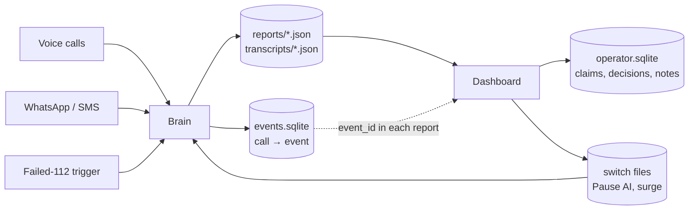
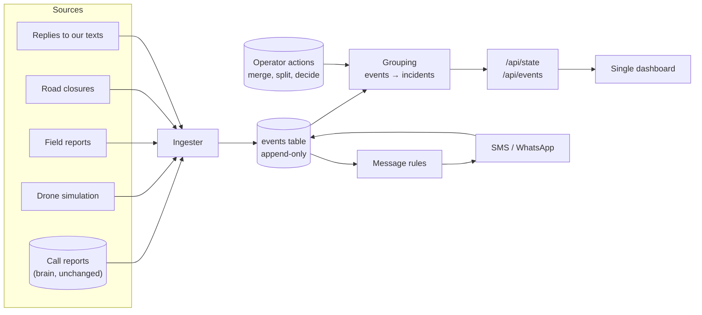
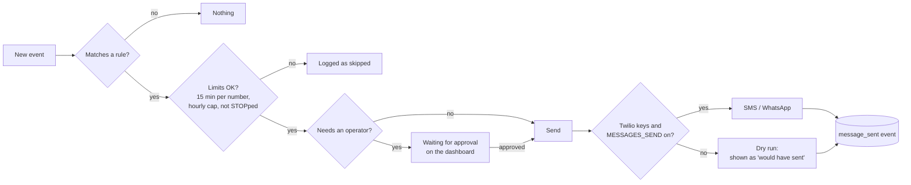

# 10 One data picture and message automations

**Summary.** Today our data sits in four separate places: one JSON report per call, a SQLite file that groups calls into events, another with operators' decisions, and small switch files. The dashboard joins them itself. After Chaos will add drones, phones detected under rubble, field reports, road closures and people's replies to our texts, and they should all appear on one map. The proposal: **every piece of information becomes a timestamped event** with the same few fields (where, when, from whom, how sure), events are grouped into incidents, and the dashboard reads one API. Message automations become **rules on those events**: when X happens, send this fixed text, either automatically or after an operator approves. The brain's contract and report format do not change.

This doc is the plan for joining the data. The work splits in two: the data side (this doc) and how it is presented on the single dashboard. Nothing here is built yet.

## What we have today

| Data | Written by | Where | What is in it |
|---|---|---|---|
| Call report | Brain, after every turn | `output/reports/<call_id>.json` | Location, hazard, people, urgency suggestion, advice given, status. Format: [06](06_Report_Structure.md), `brain/report.py` |
| Transcript | Brain, after every turn | `output/transcripts/<call_id>.json` | Every line, with the language and an English copy |
| Event grouping | Brain (`events.py`) | `output/events.sqlite` | Which call belongs to which event (same hazard, place, time window) |
| Operator actions | Dashboard (`store.py`) | `output/operator.sqlite` | Claims, urgency decisions, resolutions, notes, each with name and time |
| Switches | Dashboard → brain (`control.py`) | `output/AI_PAUSED.json` and the surge-mode file | Pause AI, surge mode |
| Spending | Brain (`budget.py`) | `output/budget.sqlite` | Gemini requests per hour and day |
| Map caches | Brain and dashboard | `output/geocode.sqlite`, `places.sqlite`, `osm/index.sqlite` | Looked-up places and streets |
| Open text conversations | Messaging server | In memory (`channels/conversations.py`) | Who is mid-conversation on SMS or WhatsApp |

All channels (voice, WhatsApp, SMS) write the same report format, so calls and messages already appear on one dashboard. What we lack is a place for **everything that is not a call**.

## What After Chaos adds

From the After Chaos plan and docs [08](08_Drone_Beacon_Network.md) and [09](09_Location_Questioning.md):

| Source | What it tells us | Status |
|---|---|---|
| Drone beacon | A phone detected under rubble, with an estimated position and circle | Planned ([08](08_Drone_Beacon_Network.md#build-plan)); simulated for the demo |
| Drone network | Where drones, relays and batteries are; which links are weak | Planned; simulated |
| Drone reconnaissance | Images and positions of collapses, blocked roads, fire or flood edges | In the After Chaos plan; images flagged for a person to check |
| Field reports | What crews on the ground report | In the plan; no format yet |
| Road closures | Which roads are blocked, since when | In the plan; no source yet |
| Replies to our texts | "We are safe", "3 people here", "still trapped" | Partly: replies to the failed-112 text already become a report |
| Crews | Who is available, where, with what skills | Needed by the allocation engine; not in our repo |

The After Chaos plan already states the rule we follow: each item becomes a timestamped event; the system groups reports that probably describe the same incident and keeps where every piece came from; operators see the source, confidence and age of each item and can merge, split, correct or dismiss incidents.

## The proposal: everything is an event

### One shape for every event

Each event has the same envelope. The full original (a call report, a drone image, a field report) stays where it is; the event points to it.

| Field | Meaning | Example |
|---|---|---|
| `id` | Unique, never reused | `ev-7f3a…` |
| `kind` | What it is | `call_report`, `phone_detected`, `drone_image`, `field_report`, `road_closed`, `status_reply`, `message_sent`, `operator_action` |
| `source` | Who or what produced it | `voice_agent`, `sms_agent`, `drone:beacon-3`, `crew:USAR-2`, `operator:Maria` |
| `observed_at` | When it was true in the world | Time of the caller's last update, of the drone's detection |
| `received_at` | When we got it | Usually the same; later for logs imported after the fact |
| `location` | Where, and how exact | Point plus a radius in metres, plus how it was found: `gps`, `building`, `street`, `area`, `estimate` |
| `hazard` | Category and kind, as in the report | `earthquake` · `collapse` |
| `people` | Counts, as in the report | trapped, injured, dead, `at_least` |
| `confidence` | How sure the source is, 0 to 1 | Call: the AI's confidence (max 0.95); detected phone: from the simulation |
| `stale_after` | When it stops being current | Road closure: 30 min unless confirmed again |
| `ref` | Link to the full original | `reports/vo-1234.json` |
| `incident_id` | The incident it was grouped into (a suggestion until an operator agrees) | `evt-earthquake-0007` |
| `personal` | Whether it holds personal data | `true` for call reports; decides what leaves the control room ([07](07_Privacy_and_Encryption.md)) |

How each source fits:

| Source | `kind` | `location` from | `confidence` from |
|---|---|---|---|
| Call or message | `call_report` | The report's location; radius from how exact it is (building ±30 m, street ~250 m, area outline) | `urgency.confidence` |
| Drone beacon | `phone_detected` | The estimated position and its circle | The detection model |
| Drone image | `drone_image` | The drone's position and the camera's view | A person's check sets it high; an automatic flag stays low |
| Field crew | `field_report` | The crew's GPS | High: a trained person on site |
| Road closure | `road_closed` | The road's line | The source (police, crew, drone) |
| Reply to our text | `status_reply` | The original call's location | Medium: a person said it, unchecked |
| Our own messages | `message_sent` | The recipient's incident | Not used |
| Operator action | `operator_action` | The incident | Not used: it is a decision, not a fact |

### Events → incidents

Incidents stay what the dashboard shows today: a group of calls about one place. The EIDO standard works the same way: one incident links many calls and other reports ([06](06_Report_Structure.md)). Incidents now also take other kinds of events.

- **Calls** keep the brain's grouping (`events.py`): same hazard, close in place, inside a time window per hazard (200 m and 6 h for an earthquake, and so on). Nothing changes there.
- **Phones detected by a drone beacon** join the incident of the collapse the beacon was sent to. A detection far from any incident opens a new one and is flagged as new.
- **Drone images and field reports** join the nearest incident of the same hazard within its radius. If none, they open one.
- **Road closures are context, not incidents.** They are a map layer and a warning on the incidents they cut off ("access road closed since 14:10").
- **Operators always win.** An operator can merge two incidents, split one, move an event, or dismiss it. These are operator actions, stored like claims and decisions today, and the grouping never undoes them.

### Several sources make an incident more certain

After Chaos says a beacon, a caller and a drone report from the same building should raise confidence together. Research on call-takers found the same: many reports from one place are a signal in themselves, and crisis-mapping projects such as Ushahidi in Haiti relied on "verification by aggregation". The simple, honest version:

- Show **which kinds of evidence** an incident has: "2 calls · 1 phone signal · 1 drone image", each with its age.
- Mark an incident **corroborated** when at least two different kinds agree on the place.
- Do **not** multiply confidences into one made-up probability. The sources are not independent (two callers may be in the same room), and a single number hides why.

### Age and staleness

Information ages at different speeds, and old information shown as current is dangerous.

| Kind | Stale after (starting values) | Why |
|---|---|---|
| Call report | 30 min since its last update (markers already fade after 30 min) | People move, situations change |
| Phone detected | 10 min without a new detection | The phone may have died or moved |
| Road closure | 30 min unless confirmed again | Roads get cleared |
| Drone image | 60 min | Collapses don't move; fire and water do |
| Field report | 30 min | |

Stale events stay visible, greyed, with their age. They never disappear silently.

## Where it is stored

| Option | Good | Bad |
|---|---|---|
| Keep today's files and add more | No changes | Every new source needs its own reader; no single history |
| **One SQLite file, `output/after_chaos.sqlite`, with an append-only events table** (recommended for the hackathon) | One place; works across our processes, like `events.sqlite` already does; nothing to install | One machine only |
| PostgreSQL with [PostGIS](https://postgis.net), as in the After Chaos plan | Real geographic queries ("everything within 500 m"); many users | Setup and hosting; more than a demo needs |

**Recommendation:** one SQLite file now, built so it can move to PostGIS later (same tables, same fields).

**Append-only:** events are added, never changed or deleted. A correction is a new event pointing to the old one. This is the well-known "event sourcing" pattern: the current picture is worked out from the list of everything that happened, so the history is never lost. It gives a full record of who knew what when, which the EU AI Act asks of high-risk systems: automatic logging (Article 12) and human oversight (Article 14; see [05](05_Urgency_and_EU_AI_Act.md)).

**The brain does not change.** It keeps writing its report files. A small **ingester** watches `output/reports/` (the dashboard's `ReportFolder` already re-reads only changed files) and turns each new or changed report into a `call_report` event. The contract in `brain/contract.py` stays as it is.

## One API for the dashboard

The dashboard already polls `/api/state` (every 2 s on this computer, every 10 s over the internet). Extend it rather than start again:

| Route | Returns | New or existing |
|---|---|---|
| `GET /api/state` | Incidents and counts, as now; each incident gains an `evidence` list (kind, source, age, confidence) and a `corroborated` flag | Existing, extended |
| `GET /api/events?since=<time>&kind=…` | Events since a time, for timelines and layers | New |
| `GET /api/layers/drones`, `/phones`, `/roads` | Map layers that are not incidents | New |
| `GET /api/messages?incident=…` | Messages sent and received for an incident | New |
| `POST /api/messages/approve` | An operator approves a waiting message | New |
| `POST /api/incidents/merge`, `/split` | Operator merges or splits | New |

**What this means for the presentation side:** each incident carries a timeline of its events, a list of evidence by kind, and the messages sent to the people in it. Layers come from their own routes, so the map can turn them on and off. Polling stays; at our sizes (hundreds of incidents) it is enough.

## Message automations

### What exists today

| Automation | Trigger | What is sent | Safeguards |
|---|---|---|---|
| Failed 112 call | `POST /112/call-failed` from the network or 112 centre | First SMS or WhatsApp: your call didn't get through, this is the automated assistant, what happened and where? | Closed without `TRIGGER_TOKEN`; one message per number per 15 min; skipped if a conversation is open; dry run without Twilio keys |
| Replies by text | Every incoming SMS or WhatsApp | The brain's reply, ending with one list of what is still missing | One reply per message; SMS kept short (70 characters per part in Greek and Turkish) |

Everything else (call-backs, follow-ups) is done by hand: the dashboard's *📞 Call back* button opens the computer's phone app.

### Proposed automations

Each one is a rule: **when** an event matches, **send** a fixed text (from JSON, like the advice, never written by the model), **through** a channel, **after** automatic or operator approval.

| # | When | Send | Approval | Why |
|---|---|---|---|---|
| 1 | A 112 call failed | (exists) First message asking what happened and where | Automatic | Already built |
| 2 | A drone beacon detects a phone | "Rescuers know there is a phone here. Reply with how many people are with you. Keep your battery: low-power mode, screen dim. Don't use airplane mode." | Automatic, once per phone | Fast, no promise of help, and the reply tells rescuers who is there ([08](08_Drone_Beacon_Network.md#what-it-does)) |
| 3 | A life-threat call dropped mid-call | "Your call was cut off. Reply here with what is happening, or call 112 again." | Operator approves (one click), or automatic after 2 min if nobody has called back | The dashboard already tags these "Line dropped: call back" |
| 4 | A call ended with the location not confirmed | "Please confirm where you are: [the address as recorded]. Reply YES or correct it." | Operator approves | The dashboard already warns "⚠ location not confirmed" |
| 5 | Civil Protection issues an order for an area (evacuate, shelter location) | The order, word for word, to people **who contacted us** from that area | Always an operator, from an approved template | We have their numbers; area-wide alerts are 112's own system (below) |
| 6 | An incident is resolved | "Your report has been handled. If anything changes, call 112." | Operator, as part of *Mark resolved* | Closes the loop without promising anything |
| 7 | An operator writes a message | Free text, or a template, to the people in one incident | The operator is the approval | For what rules don't cover |

**Not ours: alerts to everyone in an area.** EU countries must run a public warning system that reaches phones in an area (European Electronic Communications Code, Article 110), and Greece's 112 already does: during Storm Daniel in 2023 it had sent at least 14 warning messages to Thessaly and Central Greece by the middle of the storm, among them "Volos has flooded, limit your travel" and orders to get ready to evacuate villages. We only message people who contacted us, were detected by a beacon, or whose 112 call failed. We do not build a parallel alert system.

### Rules every automation follows

- **Fixed texts only**, in `phrases.json`-style JSON with a `"_status": "DRAFT"` until checked, in all four languages, with short SMS versions. The model never writes a message.
- **Never promise help.** The same rule as on calls (`core._no_promises`): no "help is on the way".
- **One message per number per rule per 15 minutes**, as the failed-112 trigger already does. Never text someone mid-conversation.
- **A cap per hour** for each rule and for all of them together: SMS costs money and the Twilio trial has 100 messages in total.
- **Dry run by default.** Without Twilio keys, or with `MESSAGES_SEND=off`, the message is logged and shown on the dashboard as "would have sent".
- **Every message is an event** (`message_sent`), shown on the incident's timeline with who approved it.
- **Replies come back as events** (`status_reply`) and through the brain, as texts do today.
- **STOP works.** Replying STOP stops all automatic messages to that number. Twilio already blocks further SMS after STOP, QUIT, CANCEL and similar English words by default; Greek and Turkish words (ΣΤΟΠ, DUR) need its "Advanced Opt-Out" setting, or our own check before sending.
- **No personal data in group messages.** A Civil Protection order sent to many people names no one.
- **Language** from the country code, then from how the person writes, as today (`brain/langs.py`).

## Who does what

A proposal, to agree:

| Part | Who | Notes |
|---|---|---|
| Event format, ingester, storage, grouping across sources, API routes | Data side (Ioannis) | This doc |
| Message rules, limits, sending, dry run | Data side (Ioannis) | Builds on `channels/trigger.py` |
| Fixed message texts in four languages | Whoever owns the brain's phrases (Aigeus) | Same review as the advice texts |
| The single dashboard: layers, evidence list, timeline, message log, approval buttons, merge and split | Presentation side | Works from the API routes above; can start on fake data before the routes exist |
| Brain | Aigeus | No change needed; the contract stays |

The dashboard code today is Aigeus's (`dashboard/`). The new routes would live next to his, so agree on it before building.

## Plan of commits

None of these are built. Each works on its own and has its own unit tests (CLAUDE.md).

| # | Commit | Gives |
|---|---|---|
| 1 | Add the event log and the report ingester | `after_chaos.sqlite` with the events table; every call report becomes an event; nothing on the screen changes |
| 2 | Group events from every source into incidents | Incidents with `evidence` and `corroborated`; operator merge and split stored |
| 3 | Add the events, layers and messages routes | What the presentation side builds on |
| 4 | Add message rules with limits and dry run | Rules 2–4 and 6 in dry run; every message an event |
| 5 | Connect the drone simulation | Phones detected and drone positions arrive as events (needs the drone plan in [08](08_Drone_Beacon_Network.md#build-plan)) |
| 6 | Send approved messages through Twilio | Real sending, behind the same limits |

## Decisions needed

1. **The split of work** above: data and messages on one side, the single dashboard on the other. Which side do the message approval buttons belong to?
2. **Storage:** one SQLite file now, PostGIS later?
3. **Which messages may go out without an operator?** Suggestion: only rules 1 (exists) and 2 (beacon detected). Everything else waits for a click.
4. **Staleness times** in the table: starting values, to tune in the demo.
5. **Dashboard ownership:** agree with Aigeus where the new routes and views go.

## Open questions

- Which format will field reports and road closures arrive in? There is no source yet; for the demo they can be simulated like the drones.
- Will Greek and Turkish authorities let a non-112 service text people at all? The failed-112 trigger assumes the network or 112 centre calls us; the same question applies to every outgoing message.
- How long are events kept after the emergency, and in what form? GDPR says personal data may be kept no longer than needed (Article 5(1)(e), "storage limitation"), and [07](07_Privacy_and_Encryption.md) says as little as possible; the operator history must still be kept for accountability.
- Does the drone simulation run inside the dashboard's process or its own? Its own is safer (a crash doesn't stop the dashboard), with events as the only link.

## Sources

Our own docs and code:
- [06 Report structure](06_Report_Structure.md), [07 Privacy and encryption](07_Privacy_and_Encryption.md), [08 Drone beacon network](08_Drone_Beacon_Network.md), [09 Location questioning](09_Location_Questioning.md)
- [brain/README.md](../../brain/README.md) (report, grouping, safety rules), [channels/README.md](../../channels/README.md) (texting, failed-112 trigger), [dashboard/README.md](../../dashboard/README.md) (incidents, operator actions, design rules)
- After Chaos plan (Team Euclides Minds), sections 3 and 3.2

Outside sources:
- Public warning systems: [European Electronic Communications Code, Directive (EU) 2018/1972, Article 110](https://eur-lex.europa.eu/eli/dir/2018/1972/oj)
- Storm Daniel 112 messages: [AMNA, 14 warning messages by mid-storm](https://www.amna.gr/print/758014), [Proto Thema: "Volos has flooded", message from 112](https://en.protothema.gr/article/1409016/volos-has-flooded-emergency-message-from-112-limit-your-travel/), [CNN Greece: 112 message to get ready to evacuate](https://www.cnn.gr/ellada/story/381267/plimmyres-sti-thessalia-minyma-112-gia-etoimotita-ekkenosis-25-oikismon-se-magnisia-larisa), [Civil Protection briefing, 16 September 2023](https://civilprotection.gov.gr/sites/default/files/2023-09/CivProGR_20230916_%CE%B5%CE%BA%CF%84%CE%B1%CE%BA%CF%84%CE%B7_%CE%B5%CE%BD%CE%B7%CE%BC%CE%B5%CF%81%CF%89%CF%83%CE%B7_%CF%80%CF%85%CF%81%CE%BF%CF%83%CE%B2%CE%B5%CF%83%CF%84%CE%B9%CE%BA%CE%B7%CF%82.pdf)
- EU AI Act: [Article 12, record-keeping](https://artificialintelligenceact.eu/article/12/), [Article 14, human oversight](https://artificialintelligenceact.eu/article/14/)
- GDPR storage limitation: [Article 5](https://gdpr-info.eu/art-5-gdpr/)
- Event sourcing: [Martin Fowler, "Event Sourcing"](https://martinfowler.com/eaaDev/EventSourcing.html)
- Many reports as a signal: [Dash et al. 2022, call-takers and crowdsourced information](https://www.frontiersin.org/journals/human-dynamics/articles/10.3389/fhumd.2022.670647/full)
- STOP replies: [Twilio, opt-out keywords (SMS STOP filtering)](https://support.twilio.com/hc/en-us/articles/223134027-Twilio-Support-for-Opt-out-Keywords-SMS-STOP-Filtering), [Twilio Advanced Opt-Out](https://www.twilio.com/docs/sms/services/advanced-opt-out)
- [PostGIS](https://postgis.net)
