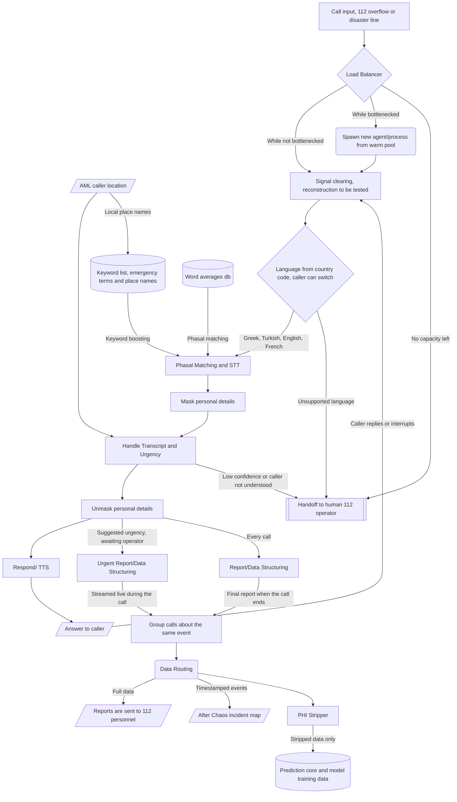

# Voice Agent Flow

## 1.1 Diagramm (Work in Progress)

## 1.2 Required Research

Findings for each point are in [Research/](Research/README.md).

 - How do we guarantee reconstruction and phasal matching can be done in greek (and turkish), languages that models haven't really been trained on?
 - TTS / STT
 - How do we structure the reports
 - What data needs to be encrypted when it reaches agents? What needs to be stripped? How do we make sure that the agents can respond even when that happens
    - (This can be done with a PHI Stripper and a good master prompt)
    - Research: the PHI Stripper works for the training copy. For the live agent we use reversible masking (Mask / Unmask nodes), see [07](Research/07_Privacy_and_Encryption.md).
 - How does load balancing work? How do we build from basic to load balanced to sharded data? Is sharding even possible here?
